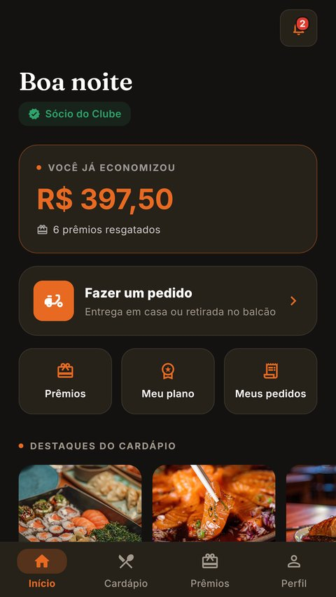
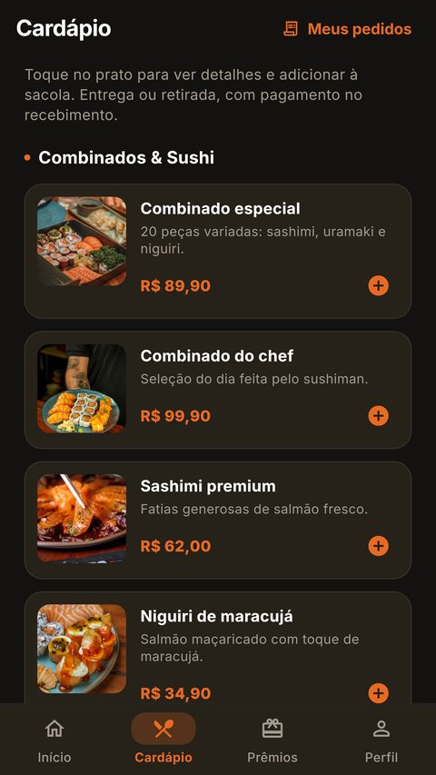
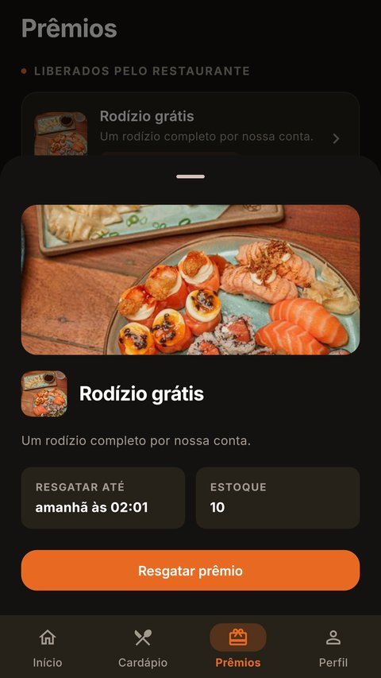
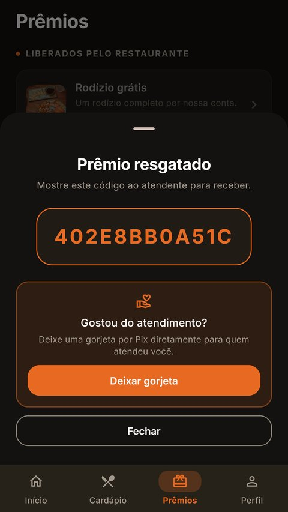
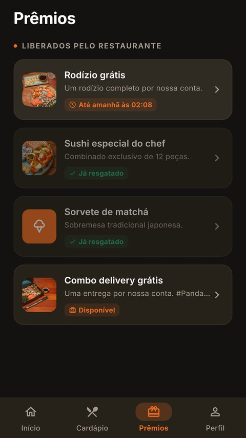
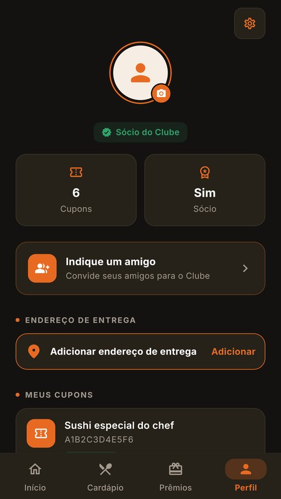

# PandaVip 🐼🍣

App de clube de assinatura que desenvolvi para um restaurante japonês de Tupã/SP. O cliente paga uma mensalidade e ganha prêmios (rodízio, pratos, sobremesas, cupons) que o dono libera pelo painel. Também tem cardápio, pedido com entrega ou retirada e gorjeta por Pix direto pro garçom.

São três partes que fiz do zero:

| Pasta | O quê | Stack |
|---|---|---|
| `app/` | App do cliente (Android, iOS e Web) | Flutter, Riverpod, go_router |
| `admin/` | Painel do dono | React, TypeScript, Vite, Tailwind |
| `firebase/` | Backend | Firestore, Auth, Cloud Functions em TypeScript, Storage, FCM |

> **Versão de demonstração.** Este repositório é uma cópia pública pra portfólio. Tirei os dados do cliente, as configurações do projeto Firebase de produção e os documentos internos (lançamento, pagamentos, integração com terceiros), então algumas referências a esses arquivos ficaram nos comentários. O app roda inteiro em **modo demo**, com dados fictícios.

## Telas

<p>
  
  
  
  
</p>
<p>
  
  
  
</p>

## Segurança

Como não tem servidor próprio no meio (o app fala direto com o Firebase), a defesa tem que morar nas regras do banco e nas Cloud Functions, nunca no aplicativo. O que fiz:

- **Nada que vale dinheiro é escrito pelo app.** Assinatura, cobrança, resgate de prêmio, virar admin e envio de push só acontecem em Cloud Function. As regras do Firestore negam escrita do cliente nesses dados.
- **Lista branca de campos** nas regras: o sócio não consegue se promover a admin nem forjar o próprio código de sócio.
- **Testes automatizados das regras** do Firestore e do Storage rodando no emulador, provando cada bloqueio.
- **App Check** (Play Integrity, App Attest e reCAPTCHA) pra barrar script usando a chave copiada do APK.
- **Limite de chamadas** por sócio e por ação nas functions.
- **Webhooks assinados** com HMAC-SHA256 e idempotência, e segredos no Google Secret Manager em vez de `.env`.
- **Painel com CSP, HSTS e X-Frame-Options**, e no Android `allowBackup=false`, ofuscação e proteção contra toque sequestrado.
- **gitleaks e npm audit** rodando toda semana no GitHub Actions.

O mapa completo, com checklist de release e plano de resposta a incidente, está em [`SEGURANCA.md`](SEGURANCA.md).

## 🚀 Rodar o app pra testar (modo demo, login de teste)

O app tem um **modo demo** que **não precisa de Firebase nem internet**: usa dados fictícios
e um login de teste já preenchido. É a forma mais fácil de rodar na máquina de qualquer
pessoa pra avaliar o app.

**Pré-requisito:** [Flutter SDK](https://docs.flutter.dev/get-started/install) instalado
(`flutter doctor` sem erros) e o Chrome.

```bash
cd app
flutter pub get
flutter run -d chrome --dart-define=DEMO=true
```

- **Login de teste:** já vem preenchido → e-mail `cliente@teste.com`, senha `123456`.
  (No modo demo qualquer e-mail/senha entra é só clicar **Entrar**.)
- Na **primeira vez** aparece o tour de boas-vindas (onboarding).
- Tudo funciona offline: carteirinha, cardápio, prêmios, notificações, perfil.

> Rodar em **navegador** (`-d chrome`) mostra o app dentro de uma moldura de celular.
> Rodar em **celular/emulador** (`-d <device>`) mostra em tela cheia.

Pra ver os dispositivos disponíveis: `flutter devices`.

---

## 📱 Funções do app (cliente)

| Tela | O que faz |
|---|---|
| **Onboarding** | Tour de 3 passos na primeira abertura (carteirinha, prêmios, notificações). Aparece só uma vez guardado em `shared_preferences`. |
| **Login / Cadastro** | Entrar por e-mail/senha. Cadastro coleta nome, e-mail, telefone (WhatsApp), **data de aniversário** e senha. |
| **Home** | Saudação, status de sócio, **sino de notificações** (com contador de não lidas), atalho da carteirinha, destaques do cardápio (fotos), promoções, "como funciona" e contatos (ligar / WhatsApp / como chegar). |
| **Carteirinha digital** | QR Code do sócio pra mostrar no caixa. Identifica o membro o direito ao resgate vem da assinatura, não dela. |
| **Cardápio** | Categorias e pratos com foto e preço. |
| **Prêmios** | Catálogo de recompensas (rodízio, sushi, sobremesa, cupom) liberadas pelo restaurante com prazo. Resgatar gera um código que o dono dá baixa no painel. |
| **Planos** | Assinatura atual, benefícios e gerenciamento (plano único R$ 4,90/mês). |
| **Notificações** | Central de avisos e promoções, com ícone por tipo (promo / aniversário / info) e horário relativo. Respeita a preferência de ligar/desligar. |
| **Perfil** | Dados do sócio, cupons resgatados, dados da conta (incl. aniversário) e **Acessibilidade**. |

### Acessibilidade & preferências (persistidas em `shared_preferences`)

- **Tamanho da letra** (A− / A+): escala o texto de todo o app (Normal → Máximo). Mantém a
  escolha entre sessões.
- **Receber notificações** (liga/desliga): quando desligado, a central mostra estado
  "desligado" e o sino some. Padrão: ligado.

### Aniversário

Coletado no cadastro (seletor de data em pt-BR) e salvo no perfil (`nascimento`). Base pra
enviar o mimo de aniversário e a notificação "Feliz aniversário 🎂".

### Notificações push (FCM)

Fora do modo demo, o app registra o token FCM no doc do usuário ao logar
(`core/services/push_service.dart`). O envio de push sai das Cloud Functions.

---

## Ordem de execução (roadmap)

1. **Firebase** projeto, Auth, Firestore + coleções, Storage, Security Rules. ✅ base
2. **Cloud Functions** custom claim `role:admin`, conceder admin, enviar push. ✅ base
   Pagamento: gateway **Mercado Pago**, ainda não integrado (detalhes num documento interno que não está nesta versão).
3. **App Flutter** design system → auth (com aniversário) → onboarding → home → premiações
   → assinatura → notificações → perfil (acessibilidade) → push.
4. **Admin React** auth+guarda admin → layout → dashboard → promoções → premiações →
   planos → membros → pagamentos → notificações → config.

## Modelo de dados (Firestore)

`users`, `subscriptions`, `plans`, `promotions`, `rewards`, `redemptions`, `payments`,
`users/{uid}/notifications`.
Detalhe em [`firebase/firestore.rules`](firebase/firestore.rules) e nos READMEs de cada projeto.

Campos novos em `users`: `nascimento` (Timestamp, opcional), `fcmToken`.

## Setup completo (com backend real)

```bash
# 1. Backend
cd firebase && npm --prefix functions install
firebase login && firebase use --add          # selecione seu projeto
firebase deploy --only firestore:rules,storage,functions

# 2. Admin
cd ../admin && npm install && npm run dev

# 3. App (requer Flutter SDK instalado)
cd ../app && flutter pub get && flutter run   # sem --dart-define usa o Firebase real
```

Variáveis de ambiente: copie cada `.env.example` para `.env` e preencha.

## Identidade visual

Paleta laranja do restaurante (`#E86A22`), preto panda quente (`#201B15`), tema claro/escuro.
Design system compartilhado em código nas duas apps.
